# ZamMove – Detailed ERD

Every stored field, plus the records nested inside a row (shown as their own boxes: USER_ROLE, VEHICLE_LEGAL, VEHICLE_DOC, SERVICE_AGREEMENT, BOOKING_EVENT, HANDOVER_CHECK, PROOF_OF_DELIVERY, PRICE_CORRECTION, CANCELLATION, INTERRUPTION, MONEY_SPLIT, RENTAL_CONTRACT, RENTAL_HANDOVER, DAMAGE_CLAIM, DEPOSIT_SETTLEMENT). Image: `ERD-detailed.png` / `ERD-detailed.svg`. Simple version: `ERD.md`.

```mermaid
erDiagram
    %% ===== People and roles =====
    USER ||--|{ USER_ROLE : "holds"
    USER ||--o{ APPLICATION : "submits"
    APPLICATION }o--|| USER_ROLE : "requests"
    USER ||--o| DRIVER_STATUS : "has (driver)"
    USER ||--o{ NOTIFICATION : "receives"
    USER ||--o{ AUDIT_LOG : "performs"

    %% ===== Fleet =====
    USER ||--o{ VEHICLE : "owns (owner)"
    VEHICLE ||--|| VEHICLE_LEGAL : "carries"
    VEHICLE ||--|{ VEHICLE_DOC : "has"
    VEHICLE ||--o{ ASSIGNMENT : "assigned through"
    USER ||--o{ ASSIGNMENT : "drives under (driver)"
    ASSIGNMENT ||--o| SERVICE_AGREEMENT : "is bound by"

    %% ===== Hauling =====
    USER ||--o{ BOOKING : "books (customer)"
    USER |o--o{ BOOKING : "drives (driver)"
    VEHICLE |o--o{ BOOKING : "used for"
    ASSIGNMENT |o--o{ BOOKING : "authorizes"
    BOOKING ||--|{ BOOKING_EVENT : "timeline"
    BOOKING ||--o| HANDOVER_CHECK : "cargo verification"
    BOOKING ||--o| PROOF_OF_DELIVERY : "closes with"
    BOOKING ||--o| PRICE_CORRECTION : "may get"
    BOOKING ||--o| CANCELLATION : "may end in"
    BOOKING ||--o| INTERRUPTION : "may stop with"
    BOOKING ||--o| MONEY_SPLIT : "settles into"
    BOOKING ||--o| REVIEW : "rated in"

    %% ===== Rentals =====
    USER ||--o{ RENTAL : "rents (customer)"
    VEHICLE ||--o{ RENTAL : "rented in"
    RENTAL ||--o| RENTAL_CONTRACT : "signed as"
    RENTAL ||--o{ RENTAL_HANDOVER : "out and back"
    RENTAL ||--o| DAMAGE_CLAIM : "may get"
    RENTAL ||--o| DEPOSIT_SETTLEMENT : "ends with"

    %% ===== Money =====
    BOOKING ||--o{ PAYMENT : "paid through"
    RENTAL ||--o{ PAYMENT : "paid through"
    USER ||--o{ PAYMENT : "pays or receives"
    USER ||--o{ REMITTANCE : "submits (driver)"
    REMITTANCE |o--|{ BOOKING : "settles"
    REMITTANCE |o--o{ PAYMENT : "uses cancel-fee credit"
    SETTINGS ||..o{ BOOKING : "prices and splits"

    %% ===== Safety =====
    USER ||--o{ INCIDENT : "reports"
    BOOKING |o--o{ INCIDENT : "about"
    RENTAL |o--o{ INCIDENT : "about"

    USER {
        string em PK "email, login id"
        string name "full name"
        string ph "PH mobile 09xxxxxxxxx"
        date dob "must be 18+"
        string ad "address"
        string pw "scrypt hash"
        bool ver "account verified"
        string code "6-digit verify code (hidden)"
        datetime codeT "code issued"
        int vatt "verify attempts, max 5"
        json reset "reset code hash, expiry, attempts"
        string lic "driver license no."
        json dx "license and clearance expiry"
        string adm "super / admin, staff only"
        bool cash "cashier staff"
        string status "active / suspended"
        json susp "reason, by, time"
        json flags "strikes and admin flags"
        bool alertsOff "no SMS alerts"
        int tv "token version, logout-all"
        datetime cr "created"
    }
    USER_ROLE {
        string t PK "customer / driver / owner"
        string st "pending / approved / rejected / revoked"
        string by FK "admin who decided"
        datetime at
        string reason "when revoked"
    }
    APPLICATION {
        string id PK "AP-"
        string user FK "applicant email"
        string role "driver / owner"
        string st "Pending Review / Under Verification / Approved / Rejected"
        string phone
        string address
        string license "driver only"
        date licExp "must be valid"
        date clrExp "NBI / police clearance"
        string note
        json files "ID, license, clearance images"
        json rec "owner invitations waiting"
        json iv "interview when / where"
        bool orient "orientation completed"
        datetime cr
    }
    DRIVER_STATUS {
        string em PK "FK to USER"
        string avail "Available / Unavailable"
    }
    VEHICLE {
        string id PK "VH-"
        string owner FK "owner email"
        string type "tw pk l3 cv w6 or rental type"
        string brand
        string model
        string plate UK "unique plate"
        string color
        int year
        string cap "load capacity"
        int seats "rental units"
        string trans "manual / automatic"
        string fuel
        string desc
        date regExp "OR/CR expiry"
        string photo
        string approval "Pending Approval / Approved / Rejected"
        string status "Available / Unavailable / On Trip / Rented"
        json rent "day rate, deposit"
        bool selfReq "owner will drive it"
        json hist "event history"
    }
    VEHICLE_LEGAL {
        string ins "CTPL policy no., required"
        date insExp
        string insDoc
        string cpc "LTFRB franchise, hauling only"
        date cpcExp
        string cpcDoc
        datetime t "recorded"
    }
    VEHICLE_DOC {
        string name "OR/CR"
        string file "image"
    }
    ASSIGNMENT {
        string id PK "AS-"
        string vehicle FK
        string driver FK "driver email"
        string by FK "owner or admin"
        string mode "owner invite / driver request / admin / self"
        string st "Waiting for Application / Pending Admin Review / Awaiting Driver / Awaiting Agreement / Pending Activation / Active / Ended / Declined"
        string note
        string req "driver request note"
        bool self "owner drives own vehicle"
        json terms "proposed driver percent"
        json hist "status history"
        datetime cr
    }
    SERVICE_AGREEMENT {
        json terms "driver percent, rules"
        string h "SHA-256 of terms, tamper check"
        json sg "owner and driver signatures"
        datetime cr "frozen on acceptance"
    }
    BOOKING {
        string id PK "BK-"
        string cu FK "customer"
        string drvUser FK "driver, set on accept"
        string drv "driver name"
        string veh FK "vehicle, from assignment"
        string rem FK "remittance"
        string pu "pickup barangay"
        string dr "drop-off barangay"
        json puC "pickup lat/lng"
        json drC "drop-off lat/lng"
        date dt "30 min to 90 days ahead"
        string tm
        string vid "vehicle type"
        string vn "vehicle type name"
        string sz "S / M / L / XL load size"
        int mv "helpers, capped per type"
        string it "items, 10+ chars"
        string ph "items photo"
        string rn "recipient name"
        string rph "recipient mobile"
        float km
        string kmBy "road / estimate"
        float tot "total fare"
        json bd "base, distance, helpers, fee"
        float disc "discount"
        string dc "discount code"
        string st "Pending / Accepted / On the Way / Awaiting Down Payment / ... / Completed / Cancelled / Interrupted"
        json declined "drivers who declined"
        datetime acc "accepted"
        datetime pendFrom "back in queue"
        bool warned "admin warned, 6h left"
        json gps "last position"
        json trail "GPS points"
        float charged "partial charge if closed early"
        float cf "cancellation fee"
        datetime cd "completed / closed"
        datetime cr
    }
    BOOKING_EVENT {
        datetime t
        string by FK "actor"
        string from "old status"
        string to "new status"
        string note
    }
    HANDOVER_CHECK {
        json items "cargo checklist: name, qty, fragile, high-value"
        int mc "item count to match"
        bool hvAny "high-value cargo"
        json qr "pickup QR hash"
        json pin "start PIN hash, SMS to recipient"
        json pinOk "verified by pin / qr, time"
        json plate "plate photo check"
        json chk "loading checklist"
        json disc "discrepancies found"
        json dconf "driver confirmation"
        json cconf "customer confirmation"
        json auth "high-value authorization"
        json exc "exception, admin waive"
        bool done "verification complete"
        json log "attempts, locks after max tries"
    }
    PROOF_OF_DELIVERY {
        datetime t
        string by FK
        string driver FK
        string note
        string photo
        string via "pin / qr / waived"
    }
    PRICE_CORRECTION {
        string pu
        string dr
        float km
        float tot "new price"
        json bd
        string why "driver reason"
        string by FK "driver"
        string ans "accepted / declined"
        datetime t
    }
    CANCELLATION {
        datetime t
        string by FK
        string from "status when cancelled"
        float fee "10% after driver left"
        bool late "driver 30+ min late, free + strike"
    }
    INTERRUPTION {
        string by FK
        string why
        string from "status when stopped"
        json done "resume / reassign / close by admin"
        datetime t
    }
    MONEY_SPLIT {
        float fare
        float fee "service fee"
        float pct "driver percent"
        float comm "ZamMove commission percent"
        float mov "helpers fee, 100% driver"
        float drv "driver share"
        float own "owner share"
        float zam "ZamMove total"
        string owner FK
    }
    REVIEW {
        string id PK "RV-"
        string bid FK "unique: one per booking"
        string by FK "customer"
        int r "1 to 5 stars"
        string t "comment"
        string sv "service feedback"
        datetime cr
    }
    RENTAL {
        string id PK "RN-"
        string cu FK "renter"
        string veh FK "vehicle"
        string owner FK
        string vt "vehicle type"
        string vn "vehicle name"
        float day "day rate"
        date s "start"
        date e "end"
        int days
        float tot "rental fee"
        float dep "security deposit"
        string pu "pickup place"
        string rt "return place"
        string lic "renter license no."
        date exp "license valid through end"
        string ip "ID photo"
        string lp "license photo"
        string st "Pending / Approved / Active / Returned / Completed / Cancelled / Rejected"
        json late "late return fee"
        float adj "adjustments"
        json split "owner / ZamMove 15%"
        json hist
        datetime cr
    }
    RENTAL_CONTRACT {
        json terms
        string h "SHA-256 of terms"
        json sg "signatures"
        datetime cr
    }
    RENTAL_HANDOVER {
        string kind "out (release) / back (return)"
        int odo "odometer km"
        string fuel "fuel level"
        json ph "photos: front, back, sides, dashboard"
        string cond "condition notes"
    }
    DAMAGE_CLAIM {
        float amt
        string reason
        string ph "photo"
        string st "Open / Disputed / Decided"
        json log "claim, reply, decision"
        datetime t
    }
    DEPOSIT_SETTLEMENT {
        float dep
        float kept "for damage / late"
        float refund "paid back, refund record"
        datetime t
    }
    PAYMENT {
        string id PK "PY-"
        string bid FK "booking OR rental id, empty for payouts"
        string kind "down / final / deposit / rent / cancel_fee / refund / deposit_refund / owner_payout"
        string method "GCash / Cash"
        float amount
        string ref "GCash ref 10-13 digits or receipt"
        string pf "proof image"
        string payer FK
        string to FK "receiver"
        string collectedBy FK "driver who took cash"
        string status "Due / Submitted / Recorded by driver / Verified / Paid / Rejected"
        string vby FK "cashier who verified"
        datetime vt
        string applied FK "remittance that used this credit"
        string note
        datetime t
    }
    REMITTANCE {
        string id PK "RM-"
        string drv FK "driver"
        string week "Monday of the week"
        json bks "booking ids settled"
        float gross "collected"
        float drvShare
        float credit "cancel fees owed to driver"
        float due "to hand to ZamMove"
        float recv "received by cashier"
        float diff "short / over"
        string method "GCash / Cash"
        string ref
        string st "Submitted / Verified / Resolved / Rejected"
        string by FK "cashier"
        datetime vt
        string note
        datetime t
    }
    INCIDENT {
        string id PK "IN-"
        string by FK "reporter"
        string kind "trip / rental / owner-report"
        string bid FK "booking or rental"
        string driver FK "for owner reports"
        string cat "category"
        string sev "Low / Medium / High"
        string w "when it happened"
        string d "description, 10+ chars"
        string ph "photo"
        string st "Submitted / Investigating / Resolved"
        string decision
        json log "case notes"
        datetime t
    }
    NOTIFICATION {
        string id PK "NT- or SM-"
        string to FK "user email"
        string h "title"
        string b "body"
        bool r "read"
        bool quiet "alerts off"
        string sim "SMS / Email (simulated inbox)"
        string addr "phone or email it went to"
        datetime t
    }
    AUDIT_LOG {
        string id PK "AU-"
        string who FK "actor"
        string evt "event name"
        json data "details"
        datetime t
    }
    SETTINGS {
        string id PK "main (single row)"
        float comm "commission %, default 15"
        float drvPct "default driver %, 20"
        float coShare "company share %, 80"
        int pendMin "minutes before warning, 30"
        float cashCap "driver cash limit, 5000"
        json rates "fare per vehicle type"
    }
```

