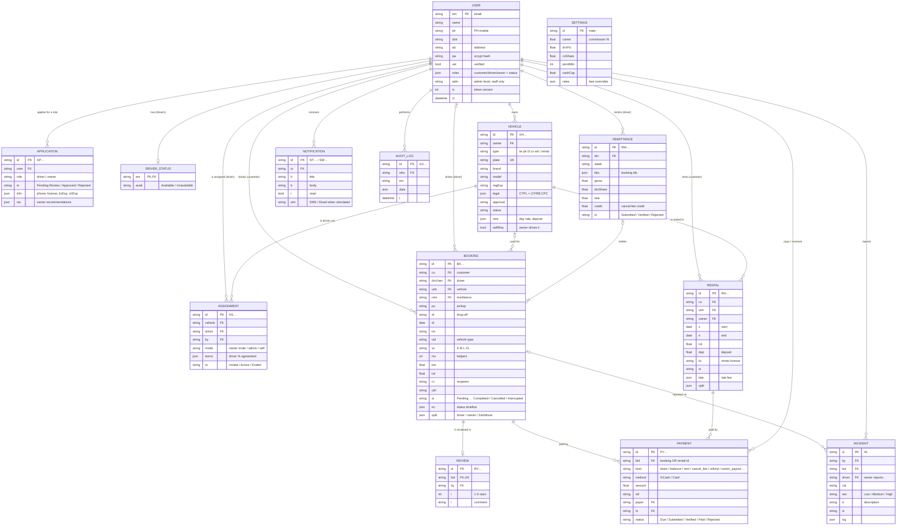

# ZamMove – Entity Relationship Diagram

Source of truth: `backend/src/state.js` (tables) and `backend/src/domain/*.js` (fields each action writes).
Every table is stored as `{ id, data }` rows (Supabase JSON or the local file store); the diagram shows the logical model inside `data`.

## Notes for reading the diagram

- **One user, many roles.** Customer, driver and owner are not separate tables. A user's `roles` list holds each role and its status, and an `APPLICATION` row is the request to get one. Staff (admin and cashier) are users with `adm` set.
- **`PAYMENT.bid` is polymorphic.** It holds a booking id (`BK…`) or a rental id (`RN…`). Owner payouts have an empty `bid` and use `to`.
- **A booking gets its driver and vehicle when it is accepted.** `drvUser` and `veh` come from that driver's active `ASSIGNMENT`. Until then they are empty, hence the zero-or-one ends.
- **A remittance settles a week of cash trips.** `REMITTANCE.bks` lists the bookings, and each booking points back through `rem`.
- **A booking has at most one review.** The rule is enforced in `bookings.js`.
- **Embedded (not separate tables):** booking timeline `ev`, assignment and rental `hist`, vehicle `legal` and `docs`, money `split`.
- **`SETTINGS`** is a single row (`main`). Admins edit fares, commission and the driver cash limit there.
